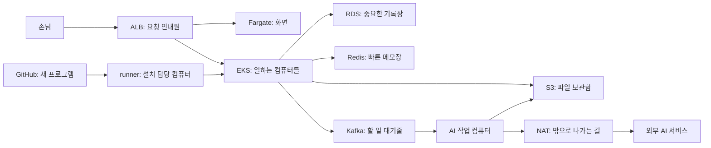

# 우리 서비스는 어디에서 일하고, 돈은 얼마나 들까요?

2026-09-16에 준비한 설정과 이후 운영 변경을 설명하는 글입니다. Redis·인증 DB·예산·AI 확장 상태는 2026-11-11 AWS 및 Kubernetes 조회 결과로 갱신했습니다. 나머지 항목은 각 절의 확인 날짜와 적용 상태를 따릅니다.

> **2026-11-11 운영 확인:** Redis 1대, 인증 DB Single-AZ, 월 실제 사용액 $50~$1000의 $50 간격 예산 20개는 적용돼 있습니다. Kafka 작업 워커 5종의 최소 Pod 수도 0입니다. 다만 11-10 검색 가용성 변경이 적용되어 embedding-server는 상시 1개이고 AI 노드도 현재 1대입니다. “유휴 시 AI 노드 0대”는 현재 평상시 정책이 아닙니다. 이 조회로 최초 적용 날짜나 실제 절감액까지 확인한 것은 아닙니다.

우리 서비스를 작은 가게라고 생각해 보세요. 손님이 보는 화면은 가게 앞이고, 서버는 뒤에서 일을 하는 컴퓨터입니다. AWS는 이 컴퓨터와 물건을 보관할 곳을 빌려줍니다.

**컴퓨터 수를 제한해도 돈이 무조건 일정해지는 것은 아닙니다.** 손님이 많아지면 보내는 파일과 AI에게 시키는 일도 많아집니다. 그만큼 돈이 더 들 수 있습니다.

## 먼저 알아둘 말

| 말 | 쉽게 말하면 |
|---|---|
| 서버·노드 | 일을 하는 컴퓨터 |
| Pod | 컴퓨터 안에서 실행되는 작은 일꾼. 컴퓨터 한 대에 여러 개가 있을 수 있어요 |
| 배포 | 준비한 프로그램을 컴퓨터에 올려서 일하게 하는 것 |
| 트래픽 | 손님이 보내는 요청과 오가는 파일의 양 |
| 자동 확장 | 일이 쌓이면 정해진 범위 안에서 컴퓨터나 일꾼을 늘리는 것 |
| 로그 | 컴퓨터가 쓴 일기. 무슨 일이 있었는지 기록해요 |
| 암호화 | 열쇠가 있어야 내용을 읽을 수 있게 잠그는 것 |

## 구성 한눈에 보기



화면과 API 모두 같은 ALB 입구로 들어옵니다. 손님은 화면을 거치지 않고 서버 입구로 직접 요청할 수도 있습니다. 그래서 화면의 버튼만 막는 것으로는 충분하지 않습니다. 서버 입구에도 제한이 필요합니다.

## 무엇을 몇 개 준비했나요?

상품 이름처럼 보이는 `t3.large` 같은 글자는 컴퓨터 크기의 이름입니다. 이름을 외울 필요는 없습니다.

| 하는 일 | 준비한 크기·개수 | 알아둘 점 |
|---|---|---|
| 컴퓨터를 둘 곳 | AWS 서울, 서로 다른 두 구역(AZ), 바깥/안쪽 공간(subnet) 각각 2개 | 두 구역을 쓴다고 모든 장비에 예비 장비가 있는 것은 아니에요 |
| 일꾼 관리자 EKS | Kubernetes 1.35 | 컴퓨터를 관리하는 부분도 돈이 들어요 |
| 보통 일을 하는 컴퓨터 | t3.large, 처음 2대·최소 2대·최대 5대 | (11-02 변경, 적용 전) 평소 2대를 목표로 해요. 프로그램 교체(rollout) 중에는 잠깐 3대째가 켜질 수 있고, 자리가 모자라면 Cluster Autoscaler가 최대 5대까지 켜고 끝나면 약 10분 쉬었다가 줄여요. 코드는 추가 CPU 요금 대신 속도를 제한하는 Standard 설정이지만, 실제 운영 컴퓨터는 `unlimited`로 돌고 있는 것을 11-02에 발견했어요(아래 미해결 항목) |
| 화면 Fargate | 화면 Pod 2개, 각각 0.25 vCPU·768Mi 요청 | 컴퓨터를 빌리지 않고 Pod 크기만큼 시간당 내요. 추가 몫까지 합쳐 Pod 하나를 0.25 vCPU·1GB로 계산해요 |
| AI 일을 하는 컴퓨터 | m5·m5d·m6i·m7i.xlarge 중 Spot, 상시 1대·최대 4대 | (11-11 운영 확인) MCP 위키 검색 때문에 embedding-server가 상시 1개라 이 컴퓨터도 1대는 늘 켜져 있어요(아래 절). 11-02에는 유휴 시 0대를 목표로 했지만 지금은 검색 서버 때문에 1대를 유지해요. 전체 절전에서 깨어나거나 Spot 노드를 교체하면 컴퓨터·모델 준비에 시간이 걸려요. GPU는 없어요. Spot은 AWS 사정에 따라 중단될 수 있어요 |
| 설치 담당 runner | t3.small 1대, 잠긴 gp3 저장 공간 30GB | 외부 공개 IP가 없고 Standard 설정을 써요 |
| 중요한 기록장 RDS | PostgreSQL 16, access db.t4g.micro·core db.t4g.small, 각각 gp3 30GB | 외부에 열지 않고 암호화해요. (11-11 운영 확인) 로그인 DB(access)와 문서·AI DB(core) 모두 Single-AZ이고 대기 중 변경이 없어요. 백업 7일 보관은 그대로예요 |
| 빠른 메모장 Redis | cache.t4g.micro 1대 | (11-11 운영 확인) 실제 1대이며 예비 복사본·자동 장애 조치·Multi-AZ가 꺼져 있어요. 보낼 때와 저장할 때 잠가요. 고장 나거나 교체되면 자동으로 이어받을 예비가 없어 로그인 정보 등이 사라지고 다시 로그인해야 할 수 있어요. 자동 크기 확대는 없어요 |
| 할 일 대기줄 Kafka | 1대, gp3 저장 공간 5Gi | 할 일이 너무 쌓이면 공간이 모자랄 수 있어요 |
| 요청 안내원 ALB | 앱 입구 설정(Ingress) 1개로 준비 | 앱을 설치할 때 만들어요. 화면 주소는 경로로, 두 API 주소는 주소로 요청을 나누고 HTTPS를 써요 |
| 밖으로 나가는 길 NAT | 1개, 고정 공인 IP 1개 | 길을 빌리는 돈과 자료를 옮기는 돈이 들어요 |
| 파일 보관함 S3 | 예전 파일도 보관 | 전체 크기 제한은 없어요. 오래된 파일이 계속 쌓일 수 있어요 |
| 설치용 프로그램 상자 ECR | 서비스별 보관함 5개(frontend 포함), 각각 최근 10개 보관 | 상자 10개의 크기는 서로 다를 수 있어요. 같은 이름표의 내용을 덮어쓰지 못하게 했어요 |
| Terraform 기록장 | 별도 S3에 보관, 암호화·이전 기록 보관·동시 수정 잠금 | 사용자가 올리는 파일 보관함과 달라요 |
| 돈 알림 | 계정 전체 월 실제 사용료 $50부터 $1000까지 $50마다(20개) | (11-11 운영 확인: 예산 20개와 각각 월 실제 사용액 알림) Discord에 한국어 설명과 AWS 원문을 함께 보내요. 돈을 자동으로 멈추지는 않아요 |

일반 컴퓨터 5대와 AI 컴퓨터 4대는 보통의 자동 확장 한도입니다. 일반 컴퓨터 5번째는 교체 중처럼 잠깐 필요할 때만 켜집니다. runner 1대는 따로 있습니다. 컴퓨터를 교체하는 동안 잠깐 더 생기는 것까지 막는 계정 전체의 절대 제한은 아닙니다.

## Kubernetes 확장 범위

컴퓨터를 늘리는 것과 그 안의 일꾼을 늘리는 것은 다릅니다.

| 일꾼 이름 | 준비한 수 | 어디에서 일하나요? |
|---|---|---|
| access-svc / document-svc / pipeline-api | 각각 2~4개(CPU HPA), 교체 중 임시 1개 추가 | 일반 컴퓨터. (11-02 변경, 적용 전) 실측에 맞춰 CPU 요청을 낮추고(100m·150m·150m) HPA 기준을 175%·200%로 올려, Pod 하나가 늘어나는 시점은 이전과 비슷해요 |
| ingest-worker / query-task-worker / agent-task-worker | 각각 0~4개 (11-11 운영 확인) | AI 컴퓨터 |
| maintenance-task-worker | 0~2개 (11-11 운영 확인) | AI 컴퓨터 |
| converter | 0~3개(KEDA, 대기 command 1건당 1개. 이전 1~3개) | AI 컴퓨터 |
| embedding-server | 상시 1개 (11-11 운영 확인. MCP 위키 검색용) | AI 컴퓨터 |
| edit-event-consumer / pipeline-agent-worker | 각각 1개 고정 | (11-02 변경, 적용 전) 일반 컴퓨터. 이전에는 AI 컴퓨터 |
| frontend | 2개 고정 | Fargate(컴퓨터 대신 Pod 단위로 빌림) |

**KEDA**는 대기줄에 일이 쌓였는지 보고 일꾼을 늘립니다. **HPA**는 API 일꾼의 CPU 사용량을 보고 늘립니다. **Cluster Autoscaler**는 일꾼이 들어갈 자리가 부족할 때 컴퓨터를 늘립니다. 모두 설치하고 정상 동작을 확인해야 합니다.

**11-11 운영에서는** ingest·query·agent·maintenance·converter 작업 워커의 최소 수가 모두 0이며, 조회 당시 실제 Pod 수도 0이었습니다. 하지만 embedding-server의 최소·최대 수는 모두 1이라 AI 노드는 1대를 유지합니다(EKS 노드 그룹 min=0, desired=1, max=4). 작업 워커가 0개라는 사실과 AI 컴퓨터가 0대라는 사실은 다릅니다. 전체 절전과 Spot 교체 후에는 노드·모델 준비 시간이 필요합니다. 워커가 다시 늘 때의 대기 시간과 실제 비용은 별도로 측정해야 합니다.

일꾼이 쓸 메모리에는 제한이 있습니다. 앱별 CPU 제한과 전체 작업 공간의 공통 제한(ResourceQuota/LimitRange)은 아직 없습니다. 자리가 다 차면 새 일이 기다리거나 실패할 수 있습니다. 일꾼 수를 제한해도 외부 AI에게 묻는 횟수나 글자 처리 비용까지 제한되지는 않습니다.

## 돈이 많이 들 수 있는 곳

| 무슨 일이 생기나요? | 왜 돈이 더 들 수 있나요? |
|---|---|
| 요청이 갑자기 많아짐 | ALB가 안내할 일이 늘고 인터넷으로 보내는 자료도 늘어요 |
| AI에게 계속 일을 시킴 | AI를 빌려 쓰는 회사가 요청·토큰 사용량에 따라 청구해요. 토큰은 글을 세는 작은 단위예요 |
| 큰 파일을 자주 옮김 | NAT 길과 인터넷을 쓰는 양이 늘어요 |
| DB가 오래 바쁘게 일함 | 현재 RDS T4g 상품은 추가 CPU 사용료가 생길 수 있어요 |
| 프로그램 교체 중 일반 컴퓨터 5번째가 켜짐 | t3.large 1대가 켜져 있는 시간만큼 On-Demand 요금이 더해져요. 서울 기준 시간당 약 $0.1이라 보통 교체 몇십 분이면 몇십 센트예요. 줄어들지 않고 한 달 내내 켜져 있으면 월 약 $75가 더해지므로 끝난 뒤 평소 대수로 돌아왔는지 확인해요 |
| 예비 DB·예비 Redis | 11-11 확인 결과 access DB는 Single-AZ이고 Redis도 1대라 예비 장비 비용은 없어요. 고장 때 자동으로 이어받을 예비도 없어요 |
| 파일을 계속 올리거나 고침 | 새 파일뿐 아니라 예전 파일도 보관하므로 공간이 늘어요 |
| 컴퓨터가 일기를 아주 많이 씀 | 로그를 모으고 저장하고 찾아보는 데도 돈이 들어요 |
| 대기줄·DB 공간이 꽉 참 | 서비스가 멈출 수 있어요. 실패한 일을 계속 다시 시도하면 다른 비용도 늘 수 있어요 |

작은 자료도 아주 많이 보내면 커집니다. **초당 100번 × 한 번에 1MB × 한 시간은 약 360GB**입니다. 이 숫자는 자료의 양을 보여주는 예시이지 요금 견적은 아닙니다. [ALB 요금 설명](https://aws.amazon.com/elasticloadbalancing/pricing/)

S3 전용 길(Gateway endpoint)을 쓰면 해당 S3 통신은 NAT를 거치지 않아 NAT 처리 비용을 줄일 수 있습니다. S3 저장·요청 요금은 남습니다. 손님에게 보내는 ALB 응답을 모두 NAT 사용량으로 한 번 더 세면 안 됩니다. [NAT 설명](https://docs.aws.amazon.com/vpc/latest/userguide/nat-gateway-pricing.html), [S3 전용 길 설명](https://docs.aws.amazon.com/vpc/latest/privatelink/gateway-endpoints.html)

일반 EC2와 runner는 추가 CPU 요금 대신 속도를 제한하는 Standard 설정입니다. 다만 2026-11-02에 운영 일반 컴퓨터가 실제로는 `unlimited`로 돌고 있는 것을 발견했습니다(최근 14일 추가 요금은 없었음, 맨 아래 절 참고). DB의 RDS T4g는 같은 설정이 아니므로 추가 CPU 비용을 따로 봐야 합니다. [EC2 T3](https://aws.amazon.com/ec2/instance-types/t3/), [RDS 요금](https://aws.amazon.com/rds/postgresql/pricing/)

S3에서 지금 보이는 파일을 지워도 예전 버전이 남을 수 있습니다. `tmp/`의 7일 정리만으로 모든 문서·AI 결과·예전 버전이 지워지는 것은 아닙니다. [S3 보관 규칙](https://docs.aws.amazon.com/AmazonS3/latest/userguide/intro-lifecycle-rules.html)

**예산 알림은 잔액이 떨어지면 멈추는 선불카드가 아닙니다.** 비용 정보는 늦게 들어올 수 있습니다. AWS 안내상 하루 최대 3회, 보통 8~12시간 간격으로 갱신되어 갑자기 늘어난 비용을 바로 막지 못합니다. [AWS 예산 안내](https://docs.aws.amazon.com/cost-management/latest/userguide/budgets-managing-costs.html)

## 추가한 비용 보호 설정과 적용 방법

**WAF는 입구의 문지기입니다.** 너무 많은 요청이 오면 잠시 거절합니다. 아래 값은 작은 시험 서비스용 시작값입니다. 실제 사용자를 받아 보기 전에 시험하고 조정해야 합니다.

| 설정 이름 | 지금 값 | 쉽게 풀면 |
|---|---|---|
| `waf_requests_per_ip_5m` | 3000 | 같은 접속 IP에서 5분 동안 너무 많이 요청하면 429로 거절해요. 사무실·집은 공유기 뒤 모든 기기가 공인 IP 하나로 보여요 |
| `waf_requests_total_5m` | 6000 | 모든 주소의 `/api/` 요청을 합쳐 5분 동안 너무 많으면 429로 거절해요. 화면 페이지·파일 요청은 세지 않아요 |
| `waf_emergency_block` | false | 긴급 문닫기 스위치는 꺼져 있어요. true로 바꾸고 적용하면 공개 API를 403으로 막아요 |
| EC2 CPU credit | Standard | 일반 컴퓨터·runner가 오래 바쁘면 속도를 줄여 추가 CPU 요금을 막아요 |
| S3 Gateway endpoint | 안쪽 경로에 연결 | S3 자료는 전용 길로 보내요 |
| 미완료 multipart 업로드 | 시작 후 7일 | 조각만 보내 놓고 끝내지 않은 업로드를 정리해요. 완료된 파일은 이 규칙으로 지우지 않아요 |

429는 “요청이 너무 많아요”, 403은 “이 요청은 허용하지 않아요”라는 응답입니다. 화면의 바뀌지 않는 파일(`/_next/static/`)은 IP당 제한에서 세지 않고, 전체 제한은 `/api/` 요청만 셉니다. 화면을 여는 요청이 몰려도 다른 손님의 API가 429를 받지 않게 하기 위해서입니다. 처음 값(IP당 600·전체 3,000)은 화면을 EKS로 옮긴 날 팀 전체가 쓰는 사무실 공인 IP 하나가 IP당 제한에 걸려 모든 요청이 429가 되어 올렸습니다(2026-10-05). 전체 제한은 IP 하나가 혼자 채우지 못하게 IP당 제한의 2배로 둡니다. WAF가 정확히 3,000번째 또는 6,000번째에서 즉시 문을 닫는 것은 아닙니다. 판단하고 전달하는 시간이 있습니다. [WAF 요청 제한](https://docs.aws.amazon.com/waf/latest/developerguide/waf-rule-statement-type-rate-based.html)

여러 손님이 같은 회사 네트워크나 중간 서버를 거치면 같은 IP로 보일 수 있습니다. 이때 정상 손님들도 함께 제한될 수 있습니다. 예전에는 화면 서버(Vercel)가 API를 대신 불러 모든 로그인이 Vercel IP로 보였지만, 지금은 브라우저가 ALB를 직접 부릅니다. IP라고 적힌 요청 글자(`X-Forwarded-For`)를 아무 확인 없이 믿도록 하지는 않았습니다. 문지기 WAF 자체에도 사용료가 있습니다. [WAF 요금](https://aws.amazon.com/waf/pricing/)

### 운영자가 실행하는 순서

여기부터는 실제 설치 명령입니다. 코드 안의 영어 이름은 컴퓨터가 읽으므로 바꾸지 않습니다.

1. 필요하면 `feedback.tfvars`에서 위 WAF 값 세 개를 바꿉니다.
2. 새 계획을 만듭니다. 기존 plan은 나중에 바꾼 설정을 자동으로 담지 않습니다.

   ```bash
   terraform -chdir=infra/terraform plan -var-file=feedback.tfvars -out=feedback-cost-guards.tfplan
   ```

3. 만들 것·바꿀 것·지울 것을 확인한 뒤 적용합니다. **apply부터 실제 자원을 만들고 요금이 생길 수 있습니다.** 이 명령은 WAF만이 아니라 같은 폴더의 전체 인프라에 적용됩니다. 이미 쓰는 컴퓨터가 있다면 교체·성능 변화도 확인합니다.

   ```bash
   terraform -chdir=infra/terraform apply feedback-cost-guards.tfplan
   terraform -chdir=infra/terraform output -raw waf_acl_arn
   ```

4. 출력된 ARN을 배포 JSON의 `waf_acl_arn`에 넣습니다. ARN은 AWS 물건의 긴 이름표입니다. GitHub의 `AWS_DEPLOY_CONFIG_JSON`에도 넣습니다. 빠져 있거나 다른 계정·리전의 이름표이면 배포 검사가 멈춥니다. 예전 배포로 되돌릴 때도 이 새 입력값이 필요합니다.
5. 앱 배포 후 WAF가 ALB 입구에 실제로 붙었는지 확인합니다. WAF만 만들고 연결하지 않으면 문을 지키지 못합니다. `<ALB_ARN>`은 실제 ALB 이름표로 바꿉니다.

   ```bash
   aws wafv2 get-web-acl-for-resource --region ap-northeast-2 --resource-arn <ALB_ARN>
   ```

6. 별도 시험 환경에서 요청 제한과 다시 정상으로 돌아오는 것을 확인합니다. `AllowedRequests`는 통과한 수, `BlockedRequests`는 막은 수입니다.
7. 급할 때는 `waf_emergency_block = true`로 바꾸고 새 계획을 확인한 뒤 적용합니다. 열 때는 false로 되돌려 다시 적용합니다. **이미 시작한 일과 대기줄에 있는 일은 이 스위치만으로 멈추지 않습니다.**

WAF가 살펴본 개별 요청을 표본으로 저장하는 기능은 껐습니다. 요청 수 기록은 켰습니다. WAF 요청 로그는 14일 보관하며, Authorization·Cookie·X-API-Key·query는 가립니다. 차단 건수 알림은 [CloudWatch 문서](aws-observability.md)에 있습니다.

## 손님을 받기 전에 더 해야 할 일

1. **AI 용돈 제한:** 사용자마다 하루에 시킬 수 있는 일·토큰·금액을 제한해야 합니다. 동시에 여러 일을 보내도 한도를 넘지 못하게 하고, 실패한 일의 반복 횟수도 제한해야 합니다. 2026-11-02에 서비스 저장소 브랜치에 하루 금액·토큰·동시 실행 제한을 만들었지만 아직 운영 배포 전입니다(맨 아래 절).
2. **파일 크기 제한:** 한 번에 올릴 크기·개수와 한 사람이 보관할 총량을 정해야 합니다. 2026-11-02에 서비스 저장소 브랜치에 만들었지만 아직 운영 배포 전입니다(맨 아래 절).
3. **알림 시험:** Discord 웹훅을 넣고 진짜로 알림이 오는지 확인해야 합니다. Kafka 대기줄·디스크, AI 호출량, CPU credit 등 아직 연결하지 않은 기록도 보완해야 합니다.
4. **요금 다시 계산:** 평소와 아주 바쁠 때를 나눠 계산해야 합니다. AI 컴퓨터가 계속 켜지는 시간도 넣습니다. 월 730시간 같은 계산 기준과 세금·환율·Spot 가격 변화를 따로 표시합니다.

기존 **월 $500~650은 예상치이며 최대 금액 보장이 아닙니다.** 2026-11-02 기준 실제 운영은 월 약 $680 수준으로 보고, 맨 아래 절의 변경을 적용하면 약 $185 줄어들 것으로 어림합니다. 이 값은 access DB Multi-AZ·Redis 예비 복사본·일반 컴퓨터 최대 5대로 바꾸기 전에 계산했으므로 다시 계산해야 합니다. 외부 AI API 사용료는 별도입니다. 화면을 Vercel에서 Fargate로 옮기면서 Vercel 요금은 없어지고 Fargate 요금이 더해집니다. 서울 기준 대략 vCPU 시간당 약 $0.05, GB 시간당 약 $0.0055로 보면 Pod 하나(0.25 vCPU·1GB × 730시간)는 월 약 $13~15, 2개는 **월 약 $30 이하**입니다. 이 값은 추정이므로 [AWS 요금 계산기](https://calculator.aws/)와 [Fargate 요금](https://aws.amazon.com/fargate/pricing/)으로 확인해야 합니다. CloudWatch 수집 비용도 함께 다시 계산해야 합니다.

## 갑자기 바빠지면 어떻게 하나요?

먼저 그래프를 보고 요청·파일·AI 작업 중 무엇이 늘었는지 찾습니다. 비용 화면에 숫자가 나올 때까지 기다리지 않습니다. 원인이 된 요청을 줄이고, 필요하면 새 API 요청을 막습니다.

일꾼을 직접 멈출 때는 KEDA가 다시 늘리지 않도록 함께 확인해야 합니다. 컴퓨터를 강제로 꺼도 Auto Scaling이 다시 만들 수 있습니다. AI API 키를 막으면 다른 정상 작업도 멈출 수 있습니다.

문을 닫아도 컴퓨터·DB·NAT·저장소를 빌린 기본 비용은 남습니다. 돈이 넘었다고 모든 자원을 자동 삭제하면 중요한 자료를 잃을 수 있습니다. 해결 후에는 남아 있는 대기줄과 중복 실행을 살피며 천천히 다시 엽니다.

## 더 볼 곳

[전체 준비물 목록](aws-resource-inventory.md), [CloudWatch 안내](aws-observability.md), [runner 설치 순서](../infra/runner/README.md), [운영 설계 기록](adr/0021-aws-observability-and-operations.md).

설정 파일: [EKS](../infra/terraform/eks.tf), [runner](../infra/terraform/runner.tf), [RDS](../infra/terraform/rds.tf), [Redis](../infra/terraform/elasticache.tf), [길 설정](../infra/terraform/vpc.tf), [앱 입구](../k8s/overlays/aws/ingress.yaml), [S3](../infra/terraform/s3.tf), [ECR](../infra/terraform/ecr.tf), [예산](../infra/terraform/budgets.tf), [비용 보호](../infra/terraform/cost-guards.tf), [배포 검사](../scripts/aws_deploy.py), [일꾼 수 조절](../k8s/base/keda-scaledobject.yaml), [AWS 앱 설정](../k8s/overlays/aws/kustomization.yaml), [대기줄](../k8s/base/kafka.yaml).

## 2026-11-02 운영 비용 최적화

일반 노드 4대의 실측 CPU 사용률은 2~6%, 메모리는 26~37%였지만 CPU request 비율은 69~82%라 자동 축소 후보가 없었습니다. CloudWatch Agent의 CPU request를 250m에서 50m로 조정하고 Cluster Autoscaler의 `scale-down-utilization-threshold`를 0.7로 설정합니다. 이 값은 실제 CPU 사용률이 아니라 예약량 기준 후보 판정이며, 재배치 가능성·PDB 검사는 계속 적용됩니다. 최소 2대/최대 5대와 앱 replica·HPA는 유지합니다. Kafka가 있는 노드를 강제로 종료하지 않습니다.

Container Insights는 10분 간격으로 수집하고 관련 경보도 10분 구간으로 평가합니다. 동일 노드·Pod 수라면 주기적 관측 횟수는 기존 5분 대비 약 절반이지만, CloudWatch 총요금 절반을 의미하지는 않습니다. Autoscaler 로그는 verbosity 4에서 2로 낮춥니다. 감사·인증·애플리케이션 로그 보관과 ALB/DB 경보는 유지합니다. 적용 후 노드 수, Agent 설정, 새 지표 수신과 ALB target 상태를 확인해야 합니다.

자동 축소를 막던 `pipeline-api`의 `runs`와 EBS CSI controller의 `socket-dir`에만 `safe-to-evict-local-volumes`를 지정합니다. API의 영속 상태·로그는 RDS/S3에 있고 `runs`는 scratch이며, CSI의 해당 볼륨은 Unix socket입니다. worker·converter·Kafka에는 이를 적용하지 않습니다. API 2 replicas, `maxUnavailable: 0`, PDB 최소 1개를 유지합니다. 장시간 연결은 기존 종료 유예를 넘으면 재연결이 필요할 수 있습니다.

현재 로컬 tfvars에 ALB 식별자와 실제 5개 managed addon 버전을 보완했습니다. 이전 파일에는 ALB 값과 metrics-server 버전이 빠져 있었으므로, 다른 환경에서도 운영 값을 확인한 뒤 계획을 생성해야 합니다.

적용 확인: Terraform으로 CloudWatch 관련 8개와 EBS 애드온 1개를 제자리 수정했고 생성·삭제는 없었습니다. CloudWatch/CSI 애드온은 ACTIVE, Agent는 CPU request 50m·수집 600초, API는 2/2 Ready입니다. ALB의 access/document/frontend 대상 총 6개는 healthy였습니다. 관련 테스트 23개와 Terraform validate를 통과했습니다. 일반 노드 한 대가 2026-11-02 14:25 KST부터 자동 축소 후보로 판정됐으며, 실제 대수·청구 절감은 축소 완료와 후속 청구 데이터로 확인해야 합니다.

CloudWatch 새 수집 확인: 14:30 KST 시각의 `ContainerInsights/node_memory_utilization` 데이터가 변경 후 도착했습니다. 자원 경보는 600초, ALB 경보는 300초로 유지되고 조회 당시 모두 OK였습니다. CPU처럼 차분을 사용하는 지표는 수집기 재시작 뒤 추가 표본을 기다릴 수 있습니다.

14:38 KST 확인: 일반 ASG DesiredCapacity=3, InService=3이며 이전 노드 1대는 관리형 `Terminating:Wait` 상태입니다. 자동 축소가 API/CSI Pod를 다른 노드로 옮겼고 access/document/pipeline/frontend는 각각 2/2 Ready입니다. 종료 대기 인스턴스의 실제 과금 종료나 월 절감액까지 확정한 것은 아닙니다. AI Spot 1대, Fargate frontend 2개, DB 구성은 유지했습니다.

되돌리기: `addon-config.json`의 두 수집 간격과 해당 경보/대시보드 주기를 300초로, Agent CPU request를 250m로 복원해 새 Terraform plan을 검토·적용합니다. Autoscaler는 Helm 이전 revision 또는 이전 threshold(0.5)/verbosity(4)로 복원합니다. API/CSI의 `safe-to-evict-local-volumes` annotation을 제거하면 해당 임시 볼륨의 자동 재배치 허용을 되돌립니다. 줄어든 노드 수는 설정 롤백만으로 즉시 4대로 돌아가지 않으며 필요하면 node group 용량을 별도로 조정해야 합니다.

## 2026-11-02 추가 점검: 배포 여유와 로그 내용

`3d140ad`(2026-10-06)는 일반 노드 상한을 4→5로 늘려 rollout Pending에 대응한 변경이다. 이번 최적화도 최대 5대를 유지한다. 3대는 평시 운영 결과이며, 3대만으로 전체 릴리스가 배포된다는 검증 결과가 아니다. 점검 시 일반 노드 CPU allocatable 합계는 5790m, requests 합계 4710m로 여유 1080m였다. access/document/pipeline 동시 maxSurge=1에는 각각 250/500/500m, 총 1250m가 추가로 필요한다. hostname topology spread 때문에 노드별 여유도 충족해야 한다. 변경 전 배포 스크립트는 converter 다음 나머지 Deployment를 한 번에 apply하고 rollout status만 순서대로 기다려 실제 rollout은 동시 시작했다. 아래 후속 적용에서 수정했다.

따라서 평시 3대를 유지하더라도 배포 시 4~5대로 늘어날 수 있어야 한다. 배포 전에 일시적으로 여유 노드를 확보하거나 API 적용 자체를 순차화하는 보완이 적절하다. 기존 600초 rollout timeout 안에 노드 기동·약 2.3GB pipeline 이미지 다운로드·readiness가 완료되는지는 새 전체 릴리스로 아직 검증하지 않았다. 이 점검에서는 업무 배포나 부하 시험을 실행하지 않았다. 종료 대기였던 `i-04c172becdbf9eb03`은 terminated로 확인했다.

최근 1시간 집계(설정 변경·재배치 포함)에서 스캔한 원본 크기는 EKS 관리 로그 약 130.5MB, performance 약 55.4MB, VPC Flow Logs 약 42.7MB, application 약 21.1MB였다. 이는 CloudWatch의 청구 사용량이나 정상 상태 월 견적과 같지 않다.

- performance 메시지의 약 80%가 `ControlPlane` 유형(약 44.2MB, 54,593건)이었다. 600초 설정 후에도 5분 구간당 약 3.9~4.7MB의 ControlPlane 기록이 이어졌다. 노드 수집 간격 조정이 전체 관측량을 절반으로 줄인다고 볼 수 없다.
- VPC Flow Logs는 파싱된 메시지 크기 기준 약 98.6%가 ACCEPT였다. 정상 연결의 감사 추적을 유지하면서 S3 직접 전달로 옮기는 방안이 적합하다. S3 전달도 수집·저장 비용이 남는다.
- application에는 autoscaler와 CloudWatch Agent 운영 로그가 많다. pipeline-api는 1,275건 중 1,186건이 `/health` 포함 로그, embedding-server는 600건이 모두 해당 로그였다. 성공 헬스체크만 수집 전 제외하고 오류 응답은 유지하는 방식이 적합하다.
- metrics-server는 접근할 수 없는 Fargate kubelet을 15초마다 조회해 timeout을 반복한다. csi-snapshotter는 VolumeSnapshot CRD가 없어 watch 오류를 반복한다. 두 오류는 로그 필터로 감추기보다 사용 목적에 맞게 수집 대상·스냅샷 기능 구성을 수정해야 한다.
- audit 로그에는 leader election lease 갱신·조회와 권한 검사가 다수 포함된다. 감사 로그를 끄거나 CloudWatch 수신 뒤 필터를 추가하는 것을 유입 비용 절감책으로 취급하지 않는다.

AWS Agent 소스는 enhanced 모드에서 ControlPlane 수집도 켠다. 단순히 enhanced=false로 바꾸면 기본 Container Insights의 지표별 과금으로 달라지므로 비용 감소를 보장할 수 없다. 필요한 노드·Pod·실패 노드 지표와 경보 dimension을 보존하는 수집 필터/사용자 정의 collector 설계가 우선이다. 이 점검 이후 아래 후속 적용에서 선별 수집과 로그 전환을 진행했다.

## 2026-11-02 후속 적용: 배포 여유·선별 수집·로그 절감

- `aws_deploy.py`는 converter 준비 후 API 교체 전에 1500m CPU/3Gi 메모리의 임시 Job이 실제 Ready가 될 때까지 기다린다. 일반 ON_DEMAND 노드에서 검증된 pipeline 이미지로 Python sleep만 실행하며, 앱 환경변수·Secret·서비스 계정 토큰은 주입하지 않는다. 15분 안에 확보하지 못하면 API 배포를 중단한다. 정상/실패 모두 Job을 삭제하고, runner가 사라져도 20분 실행 제한과 TTL 60초로 예약을 해제한다. 동명 Job이 있으면 덮어쓰거나 지우지 않는다.
- API 3개는 apply 자체를 순차 실행하고 각 rollout 완료 후 다음을 시작한다. `maxUnavailable=0`, PDB, replica/HPA를 유지한다. 운영 시험에서 예약 Pod가 일반 ASG 3→4 확장을 유도하고 새 노드에서 pipeline 이미지 실행까지 성공한 뒤 삭제됐다. 전체 새 업무 릴리스/부하 시험과 같지는 않다. 배포기 코드는 저장소의 미커밋 변경이며 GitHub에서 사용하려면 해당 변경이 배포 workflow가 checkout하는 브랜치에 반영돼야 한다.
- CloudWatch는 enhanced 기본 수집 대신 이름이 분리된 사용자 정의 OTEL pipeline을 쓴다. ControlPlane 상세 수집을 끄고 5개 지표만 EMF로 전송한다. 노드 CPU/메모리·실패 노드는 ClusterName, Pod CPU/메모리는 ClusterName+Namespace=fruition dimension만 게시한다. 노드/Pod별 dimension의 대량 사용자 정의 지표 생성을 막는다. 수집 주기는 600초이며 Application Signals/GPU/중복 OTEL 수집은 계속 비활성이다. 기본 Container Insights 상세 화면의 나머지 지표는 더 이상 갱신되지 않는다.
- Fluent Bit는 정확한 Uvicorn 형식의 GET/HEAD `/health` 또는 `/healthz` 200 OK 줄만 CloudWatch 전송 전에 제외한다. 500, POST, 일반 업무 로그와 다른 API의 200은 유지한다. 운영과 동일한 Fluent Bit 이미지로 5개 입력 중 성공 헬스체크 1개만 제외되는 것을 확인했다. Fargate 자체 로거에는 이 필터가 적용되지 않는다.
- VPC ALL Flow Logs는 전용 비공개 S3 `fruition-vpc-flow-logs-273366117740-ap-northeast-2/flow/`로 직접 보낸다. SSE-S3, 공개 접근 차단, 계정/리전 제한 전달 정책, 14일 만료를 설정했다. 실제 gzip 파일의 7,202개 레코드(ACCEPT 7,109 / REJECT 79 / NODATA 7 / SKIPDATA 7)를 확인한 후 기존 CloudWatch Flow Log와 불필요해진 IAM 역할·정책을 제거했다. VPC Flow Logs는 best effort이며 SKIPDATA가 있어 완전한 패킷 감사라고 보장하지 않는다. 기존 CloudWatch log group은 Terraform moved로 소유 주소만 옮겨 14일 보관과 삭제 방지를 유지했다.

S3 직접 전달에도 vended log 전달·S3 저장/요청 비용이 남는다. 정확한 절감액은 후속 청구 사용량으로 확인해야 하며 이 계정의 Cost Explorer/Price List API는 조직 SCP로 차단돼 있다. EKS 감사·인증 로그, RDS/Redis 구성, 앱 replicas는 유지한다.

되돌릴 때는 CloudWatch 설정과 `service_account_role_arn`을 함께 Terraform으로 적용한다. CLI `update-addon`을 쓴다면 `--service-account-role-arn arn:aws:iam::273366117740:role/fruition-cloudwatch-agent`를 반드시 명시하고 실제 ServiceAccount annotation과 Pod의 IRSA 환경변수를 확인한다. 역할을 빠뜨린 갱신에서 연결이 사라져 14:54~15:01 KST 로그 전송 거부가 발생했고, Terraform 복원과 수집기 재기동으로 복구했다. 그동안의 앱 로그는 노드에 남은 원본 423건을 회수해 `recovery-20261102-addon-role` stream에 재전송했다. host/dataplane 및 수집기 로그 전체의 무손실 복구는 보장하지 않는다.

VPC 전달을 되돌릴 때는 기존 log group을 대상으로 CloudWatch Flow Log를 먼저 재생성하고 전달 성공을 확인한 뒤 S3 Flow Log를 중단한다. S3 버킷이나 보존 중인 로그를 삭제할 필요는 없다.

검증 기록: 배포 관련 테스트 79개와 maintenance 테스트 16개(총 95개), Terraform validate/fmt, diff 공백 검사를 통과했다. 15:05 KST CloudWatch API에서 5개 지표 모두 새 표본을 확인했다: 노드 CPU 최대 8.66%, 메모리 39.71%, 실패 노드 0, fruition Pod CPU 1.60%, 메모리 10.06%. EMF 원본도 지표 이름 5개, dimension 조합 2개만 포함했다. 빠른 수신 검증 동안만 receiver를 60초로 실행하고 최종 운영 주기는 600초로 복원했고 15:07 KST 재기동한 Agent 로그의 `collection_interval: 10m0s`와 Ready 상태를 확인했다. `agent.otelConfig`만 바꿔서는 실행 중인 DaemonSet이 자동 재기동되지 않을 수 있으므로 CR/ConfigMap뿐 아니라 재기동 후 Agent가 출력한 실제 collection_interval을 확인한다.

15:04~15:06 KST의 선별 수집 시험 구간은 performance 128건/약 144KB였으며 Type은 Node/Pod/Cluster뿐이고 ControlPlane은 0건이었다. 이 구간은 검증용 60초 주기이고, 과거 1시간 집계와 기간·노드 수가 달라 그대로 월 절감률로 환산하지 않는다.

15:09 KST 일반 ASG는 DesiredCapacity=3, InService=3으로 복귀했고 임시 확장 인스턴스는 `Terminating:Wait`였다. 강제 종료 없이 예약→자동 확장→Ready→예약 해제→자동 축소까지 확인했다. 최종 CloudWatch 애드온 ACTIVE/IRSA 연결 정상, 600초 실행 설정과 관련 Terraform targeted plan의 No changes를 확인했다. 새 600초 CPU 표본은 차분 계산 때문에 재시작 후 약 20분이 걸릴 수 있어, 이번 검증의 실제 5종 수신 증거는 직전 60초 시험 구간이다.

## 2026-11-02 알파 테스트 대비 비용 조정 (11-11 일부 운영 확인)

**11-11 조회로 Redis 1대·access Single-AZ·예산 20개·Kafka 작업 워커 최소 0개 적용을 확인했습니다.** embedding-server는 11-10 후속 정책에 따라 상시 1개이며 AI 노드도 1대입니다. 아래 표는 11-02 변경 의도이며, 나머지 항목의 적용 여부와 실제 절감액까지 이번 조회로 확인한 것은 아닙니다.

| 항목 | 바뀌는 내용 | 알아둘 점 |
|---|---|---|
| Redis (`elasticache.tf`) | `num_cache_clusters` 2→1, 자동 장애 조치·Multi-AZ 끔 | 노드 장애·교체 때 세션·권한 projection·SSE relay가 사라져 재로그인이 필요할 수 있음 |
| access DB (`rds.tf`) | `multi_az` true→false (core DB와 동일) | 다음 유지 관리 기간에 적용되며 AWS 문서상 중단 없음. 백업 7일·암호화·삭제 보호 유지 |
| 예산 알림 (`budgets.tf`, `budget_discord/handler.py`) | ACTUAL 기준 $50~$1000, $50마다 예산 20개 | 액션 없는 예산이라 무료. 기존 400·550·650 예산은 이름 키가 같아 다시 만들지 않음. Discord 메시지는 예산 이름·알림 기준·현재 실제 사용액·의미·확인할 일을 한국어로 먼저 쓰고 AWS 원문을 뒤에 붙임 |
| 자격 증명 경보 (`credential-guard.tf`) | `alarm_description`을 경보별 한국어 설명으로 교체 | 확인 절차 문서 링크는 유지 |
| AI 노드 0대 (`keda-scaledobject.yaml`) | Kafka worker 5종 `minReplicaCount` 1→0. `cooldownPeriod` ingest·maintenance·converter 600초, query·agent 1800초 | 쉬고 난 뒤 첫 AI 작업은 노드 확보·이미지 pull·모델 적재로 약 3~5분 늦음(cold start) |
| embedding-server | 새 ScaledObject가 query·agent worker Pod 수를 따라 0/1로 조정 | 두 worker는 init container로 embedding-server `/health`를 기다린 뒤 소비 시작 |
| worker 위치 (`kustomization.yaml`) | edit-event-consumer·pipeline-agent-worker를 AI 노드 → 일반 노드 | 상시 1개가 필요해 AI 노드에 두면 노드가 0대로 내려가지 않음. pipeline-agent-worker CPU 요청 50m |
| Kafka (`kafka.yaml`) | `offsets.retention.minutes` 525600(1년) | 기본 7일 뒤 offset이 지워지면 KEDA가 topic 전체를 lag으로 계산해 worker·AI 노드를 계속 깨움. 첫 적용 때 단일 broker가 재시작될 수 있음(약 1~2분) |
| 일반 노드 평시 2대 | API CPU 요청 access 250→100m, document·pipeline 500→150m. HPA 목표 175%/200% | 실측(2026-10-27~11-02 Pod 평균 3~14m) 기준. Pod당 확장 시점(약 175~300m)은 이전과 비슷. 배포 중에는 3대째가 잠시 켜질 수 있음 |
| 배포기 (`aws_deploy.py`) | KEDA 대상 Deployment는 `replicas`를 빼고 적용 | 배포할 때마다 0이던 worker가 1로 깨어 AI 노드를 띄우지 않게 함. init container 이미지도 release 태그 검사 대상 |

**예상 절감:** 현재 월 약 $680 기준에서 약 $185/월 줄어들 것으로 어림합니다. 공시 단가 기준 추정이며 Spot 가격·AI 작업 시간·환율에 따라 달라집니다. 적용 후 청구 데이터로 확인합니다.

**미해결 항목**

- 일반 노드 launch template이 실제로는 t3 CPU credit `unlimited`로 실행 중입니다. `eks.tf`는 `standard`로 설정돼 있어 코드와 운영이 다릅니다. 최근 14일 surplus credit 요금은 없었지만 원인 확인과 정리가 필요합니다.
- EKS 1.35 표준 지원은 2027-03-27에 끝납니다. `upgradePolicy`가 EXTENDED라 그 전에 업그레이드하지 않으면 control plane 요금이 월 약 $73에서 약 $438로 오릅니다.

**서비스 쪽 한도 (이 저장소 밖, 운영 배포 전)**

Fruition-document·Fruition-frontend 브랜치에 사용자 한도를 만들었습니다. 상세 동작은 해당 저장소 문서를 봅니다.

- AI: 사용자당 하루 토큰 1,000만(한국 시간 자정 초기화). 하루 비용·동시 실행 한도는 없앴습니다. 운영은 `AI_LIMIT_ENABLED=false`로 꺼져 있습니다.
- 업로드: PDF 100MB 이하, 사용자당 저장 공간 5GB(휴지통 포함). 하루 업로드 개수 한도는 없앴습니다. `UPLOAD_LIMITS_ENABLED` 스위치로 켜고 끕니다.
- 화면: 저장 공간 사용량 막대와 한국어 한도 안내 문구를 보여 줍니다.

## 2026-11-02 EKS 감사 로그 발생량 줄이기 (적용 전)

**저장소 코드 변경이며 아직 운영에 적용하지 않았습니다.** 감사 로그는 켠 채로, 로그를 많이 만드는 controller의 동작 주기만 늘립니다. EKS 감사 정책은 AWS가 관리하므로 바꿀 수 없습니다.

16:00 KST 전후 1시간 측정에서 `/aws/eks/fruition-eks/cluster`의 감사 로그는 약 116MB/h(약 7.8만 건)였습니다. get 42MB, update 35MB, watch 11MB 순입니다. 2초마다 갱신하는 leader election lease가 가장 큰 몫이었습니다.

| 대상 | 바꾸는 값 | 적용 방법 | 예상 절감 (MB/h) | 영향 |
|---|---|---|---|---|
| Strimzi operator | lease 15/10/2초 → 60/40/10초, 전체 재조정 2분 → 10분 | `aws-platform-up.sh` (helm) | 약 8 | operator 재시작 때 인계 최대 약 60초. 수동으로 바뀐 리소스를 되돌리는 주기가 10분. CR 변경은 지금처럼 바로 처리 |
| EBS CSI controller | provisioner·attacher·resizer lease 5초 → 10초, snapshotter 끔 | Terraform (`eks.tf` addon) | 약 6 | 리더 인계 최대 약 60초. VolumeSnapshot CRD가 없어 원래 동작하지 않던 스냅샷 기능 제거 |
| Cluster Autoscaler | lease 2초 → 10초 | helm | 약 2.3 | 리더 인계 최대 약 60초 동안 노드 확장 판단이 멈춤 |
| KEDA operator | lease 2초 → 10초 | helm | 약 2.1 | 재시작 때 확장 판단이 최대 약 60초 멈춤 |
| KEDA metrics adapter | 권한 확인 결과 캐시 10초 → 60초 | helm | 약 3 | RBAC 회수가 metrics 조회에 최대 60초 늦게 반영. 실제 HPA 요청은 kube-apiserver 감사에 그대로 남음 |

합계 약 21MB/h(감사 로그의 약 18%), 월 약 15GB, 서울 수집 단가 $0.76/GB 기준 **월 약 $11** 절감으로 어림합니다. 리더 선출은 끄지 않았습니다.

손대지 않은 항목: `system:anonymous` 약 5,000건/h는 control plane 내부(127.0.0.1)와 AWS NLB health checker의 `/healthz`·`/livez`·`/readyz` 요청이며 모두 200입니다. 정상이고 조치할 수 없습니다. `eks:*`·`system:kube-*`·HPA controller·metrics-server addon은 AWS 관리 대상이거나 설정 항목이 없습니다. AWS Load Balancer Controller(v3.5.0)는 lease 주기 설정이 없고, webhook이 `failurePolicy=Fail`이라 replica를 1로 줄이지 않습니다. CloudWatch Agent의 `cwagent-clusterleader` ConfigMap 갱신도 설정할 수 없습니다.

**적용 순서:** helm 3개(Strimzi·Cluster Autoscaler·KEDA)는 `bash scripts/aws-platform-up.sh install <terraform-outputs.json>`로 적용합니다. 앱 배포(`aws_deploy.py`)로는 바뀌지 않습니다. EBS CSI는 Terraform plan에서 `aws_eks_addon.core["aws-ebs-csi-driver"]`의 `configuration_values`만 제자리 수정되는지 확인한 뒤 apply합니다. controller Pod가 다시 뜨며 그동안 새 볼륨 연결이 잠시 늦어질 수 있습니다.

**적용 후 확인 (1시간 뒤):**

```
filter @logStream like /kube-apiserver-audit/
| stats sum(strlen(@message))/1048576 as MB, count(*) as n by user.username, verb, objectRef.resource
| sort MB desc | limit 20
```

lease update 건수가 대상별 약 1,790건/h(EBS sidecar 약 720건/h)에서 약 360건/h로, `keda-metrics-server`의 `subjectaccessreviews` create가 약 1,330건/h에서 크게 줄었는지 봅니다. snapshotter lease와 `volumesnapshot*` 404 요청은 없어야 합니다. CloudWatch `AWS/Logs` `IncomingBytes`(LogGroupName=`/aws/eks/fruition-eks/cluster`, 1시간 합계)가 적용 전 약 113~130MB에서 약 95~110MB로 내려가는지 확인합니다.

되돌리기: `aws-platform-up.sh`에서 추가한 `--set` 줄과 `eks.tf`의 `sidecars` 블록을 지우고 같은 방법으로 다시 적용합니다.

### Cluster Autoscaler 축소 시 Pod 종료 대기 900초 (2026-11-03)

Cluster Autoscaler가 노드를 줄일 때 Pod 종료를 기다리는 상한(`--max-graceful-termination-sec`)을 기본 600초에서 **900초**로 올립니다. AI worker는 `terminationGracePeriodSeconds` 900초 안에 진행 중 작업을 최대 840초까지 마무리하는데, 600초에서 끊기면 작업이 중간에 강제 종료됩니다. 위 lease 설정과 같은 `aws-platform-up.sh` helm 적용으로 반영됩니다. 영향은 worker가 있는 노드의 축소가 최대 15분 늦어지는 정도입니다. 적용 후 `kubectl -n kube-system get deploy -l app.kubernetes.io/name=aws-cluster-autoscaler -o jsonpath='{.items[0].spec.template.spec.containers[0].command}'`에 `--max-graceful-termination-sec=900`이 있는지 확인합니다.

### MCP 검색 상시 가용을 위한 embedding-server 상시 1대 (2026-11-10 변경, 11-11 운영 확인)

MCP `search_wiki`는 pipeline-api가 질의 임베딩을 embedding-server에 요청합니다. embedding-server가 AI 일꾼이 있을 때만 떠 있으면 평소 검색이 503이 되므로, 운영(AWS overlay)에서 embedding-server ScaledObject의 `minReplicaCount`를 1로 올렸습니다. 11-11 실제 ScaledObject min/max=1, Deployment Ready=1, AI 노드 1대를 확인했습니다. 로컬(base)은 0/1 그대로입니다.

- embedding-server는 AI Spot 노드 그룹(nodeSelector `fruition.io/node-role=ai-worker`)에만 뜹니다. 노드 그룹 최소값은 0 그대로이며 Terraform은 바꾸지 않습니다. Pod가 Pending이 되면 Cluster Autoscaler가 AI 노드 1대를 띄우고, 그 노드에 embedding-server가 있어 0대로 줄이지 않습니다.
- 운영자가 하는 전체 절전(request-wake Lambda `sleep`)은 그대로 모든 노드를 내립니다. 깨울 때 Lambda가 AI 노드 희망 수를 1로 올리므로 embedding-server가 다시 뜹니다. 절전 중과 Spot 회수 직후(새 노드·이미지·모델 적재 수 분) 검색은 503(재시도 가능)입니다.
- query·agent의 `wait-embedding-server` init container는 서버가 이미 Ready라 곧바로 통과합니다. AI 일꾼은 여전히 0개까지 줄고, embedding-server 하나(요청 500m/3Gi)가 있는 노드에 일꾼이 먼저 배치됩니다.

**예상 비용(추정):** AI 노드 1대가 월 730시간 켜집니다. 서울 m5.xlarge On-Demand 공시가 약 $0.236/시간을 기억에 의존한 값으로 두고, Spot이 보통 그 30~40% 수준이라고 보면 시간당 약 $0.07~0.10, **월 약 $50~75**입니다. 루트 gp3 30GB(월 약 $2.7)가 더해집니다. 이 값은 이번 작업에서 시세를 확인하지 않은 추정이며 Spot 가격·실제 배정 타입(m5/m5d/m6i/m7i)·환율에 따라 달라집니다. 적용 후 Cost Explorer의 EC2 Spot 사용량으로 확인합니다. 11-02 조정의 예상 절감(약 $185/월) 중 이 금액만큼이 줄어듭니다.
